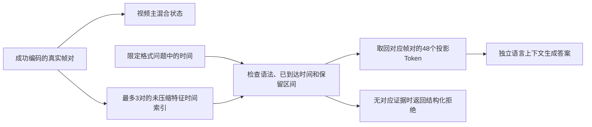

# 按时间问题选择旧证据：作用与边界

2026-10-14固定结果快照；持续进度以《实验总纲.md》为准。本轮未压缩特征，没有训练或改变默认模型，也未修改综合汇报。

**这次得到一个局部有效的读取改造：问题带明确时间时，先取对应旧帧对，再交给模型回答，能避免本轮两项混合上下文新增的毛色错误；但基础识别失败仍然存在。**

## 为什么需要它

上轮棋盘格在换片段后丢掉毛色，说明“压到同样大小”不代表信息可读。这轮先停下压缩，只保留完整原始投影，分清：旧证据本来是否可答？加入近期画面会不会错？再加入其他旧事件会不会错？

把它理解成查相册：相册里确实有猫的照片，但把猫、狗和洗手照片都摆在面前问“最早那只动物的毛色”，答案可能受其他照片影响。我们尝试让系统先根据问题中的时间，取出对应照片。

## 我们改了什么

新增独立`diagnostics/time_query_v1`，核心是`time_index.py`的`RawTimeIndex`。它不是新的视觉网络，而是有界历史证据到独立问答上下文之间的读取层：



示例支持的问句是：

```text
Name the animal visible at 0.5 seconds.
Is the animal's coat mostly light-colored or mostly dark-colored at 0.5 seconds? Answer light or dark.
```

`query(question)`只解析这两种严格模板的时间，然后按`node.begin <= time <= node.end`查节点。它不读取“狗、猫、深色”等人工真值，也不使用实验中的目标索引。`target_index`只供单旧节点的人工指定诊断臂使用；自动路由结果另算，并逐项对照。

索引最多保存3个完整帧对，即144个视觉Token；加入第4对淘汰最早的一对。每个节点为48×1024的FP32视觉投影，另有质量和来源坐标。查询返回独立副本，结束后释放问答缓存，不写回主状态或历史银行。

不支持的语法、歧义问句、未来时间、未保留区间均返回无证据；压缩节点不允许进入这个只读完整帧对的索引。相关拒绝和淘汰由CPU契约验证，不把范围元数据当成压缩后仍能准确读取每个时刻的证明。

这是**限定时间问句的确定性查找**，不是任意自然语言理解或语义事件检索。原始帧对的“完整”也只指保留了这对采样帧的全部投影：1FPS输入并没有拍到每个中间时刻，问0.5秒时读取的是覆盖0—1秒的帧对，不是凭空取得第0.5秒的一张新画面。

## 怎样比较

固定两组熟悉来源窗口，每组分别组成“狗→猫→洗手”和“猫→狗→洗手”。同组的洗手末段完全相同；动物顺序只交换相同两对画面。每例6帧、3对；会话0—5秒是合成标签，原文件帧ID、真实PTS和像素SHA另存。来源和不少窗口已有历史记录，不称为留出数据或新源泛化。

每例问0.5秒动物、2.5秒动物、0.5秒毛色。比较六条件，共4例×3题×6条件=72次真实问答：

| 条件 | 给问答模型的视觉信息 | 用途 |
|---|---|---|
| 单旧节点 | 人工指定的正确帧对，48Token | 检查基础可读性；不是自动检索成果 |
| 旧＋近期 | 目标帧对＋洗手末对，96Token | 检查加入近期画面后的变化 |
| 全历史 | 狗、猫、洗手，144Token | 检查再加入其他旧事件后的变化 |
| 时间路由 | 从问题解析时间，自动取对应48Token | 验证受限自动选择及独立读取 |
| 只交换旧值 | 保留目标文字和位置，换成另一旧动物的特征 | 人为反事实，检查答案是否受视觉值影响 |
| 仅近期 | 只有洗手末对 | 检查没有动物证据时是否仍猜动物 |

每例编码完都显式清空主混合状态，再从外部证据进行问答，排除答案偷偷依赖主缓存残留。两动物特征交换只发生在独立临时副本，并标注捐献节点，不修改真实银行或伪称那是实际视频历史。

## 效果如何

| 普通历史读取条件 | 符合人工事实的检查项 |
|---|---:|
| 单旧节点 | 10/12 |
| 旧＋近期洗手 | 10/12 |
| 全历史 | 8/12 |
| 时间路由 | 10/12 |

这是四组受控序列的相关检查，不是12个独立样本或通用准确率。

两次可定位的退化都发生在“猫→狗→洗手”里的早期猫毛色：单独读猫是深色；加洗手仍是深色；再加入旧狗变成浅色；按时间只取猫后恢复深色。开发窗口和第二组固定窗口都出现这个模式。

因此，本轮支持的是：**加入另一个旧动物后的完整上下文出现了局部干扰，选择目标节点后可以恢复该事实。** 没有证据说近期洗手画面本身导致这两个错误。混合上下文同时改变了视觉内容、长度、时间文字和应用位置；尚未做固定这些因素的进一步干预，不能把原因完全归结为狗的白色特征或某个注意力层。

时间路由12次生成ID均与人工指定单节点完全相同，说明限定格式的查找没有选错节点或改变读取行为。这是机制验证；人工指定单节点的成绩不冒充自动语义检索能力。

只交换旧节点视觉值、保持问题文字和全部位置不变时，12次中8次答案的类别或毛色随之改变；开发窗口6次全部符合替换后的动物/毛色，第二窗口仍有基础误识。反事实替换后的符合项共10/12，单独列出，不并入实际历史问答成绩。这比只展示某次答对更能说明答案确实利用了视觉证据。

## 仍然没解决什么

第二组窗口中的猫，在单节点未压缩时就被回答成狗。无论目标在开头还是中间，都未被路由修复；但该节点毛色仍能读成深色。**选对证据与理解正确仍是两步。**

仅给洗手末对，模型依旧会按动物问句回答狗、浅色。即便偶然与某例真值一致，也不能算记住了动物。这暴露了模型在缺乏相关证据时的幻觉。本索引只会在没有保留时间区间时拒绝，尚不能判断取回的画面是否真的含有问题所问对象。

当前也未证明：自由问句路由、按语义找事件、压缩森林节点精确时间检索、长期收益、速度提升或新视频泛化。这个模块只在独立实验中启用，没有接入默认演示入口。

## 核验与资源

CPU3项契约及完整随机重放通过，覆盖语法/边界/淘汰/拒绝、所有权、oracle与自动选择、仅换值控制、相同末段及时间来源区分。随机回答不做能力评分。140个源文件在运行前冻结。

真实GPU95一次载入：12次视觉、72次问答、327次语言前向、235个生成Token，全部EOS结束；含载入约24.32秒，峰allocated3.24343GiB/reserved3.56055GiB。保持FP32 IEEE/math、GDN64、主256/问答768、每答24Token、360秒watchdog及原RAM3/GPU空闲5.5/转换余量2GiB门禁；本次加载前RAM约5.76GiB、GPU空闲约6.93GiB。

RGB画布3,538,944B，外部张量保守相加2,374,272B，含额外副本/投影暂存的工作估计9,729,280B≤16MiB；不是实测进程RSS。主缓存23,470,080B和指纹临时2MiB另计。独立审计核验所有源/资产/模型/输入SHA与布局、两顺序特征一致性、4次显式主reset、72次问答隔离、12次路由同生成及12次只换值的位置文字控制，全部原答保留。

证据目录为`E:/VIT Model/runs/time_query_cpu_20261014_01`、`time_query_gpu_20261014_01`和`time_query_audit_20261014_01`。入口为个人实验目录`diagnostics/time_query_v1/run_probe.py`，先preflight，再用同源码成功证明运行gpu；完整参数和预算在冻结request/方案中。模型、媒体、环境和凭据不进入Git或小型交接备份。

## 下一步怎样收紧目标

优先验证一个问题：全历史中的毛色干扰，是否随无关节点的视觉值改变而变化。下一轮可固定全部文字、长度和位置，仅替换无关节点的值，区分视觉干扰与布局因素；这是诊断，不是新的存储模块。

若希望推进实际使用，则应先给当前读取器增加清楚的支持范围和无证据返回，随后才扩展问句语法；不急于称为通用语义检索。压缩森林继续保留为候选，先证明可读内容与选择策略，再考虑把有损节点纳入读取链路。
