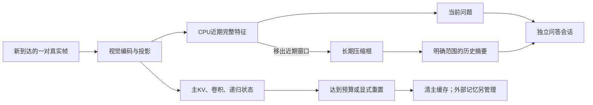

# 投影视觉压缩与长短期记忆：这一窗口的通俗复盘

2026-10-13。本页是固定实验结果及解释，持续进度以《实验总纲.md》为准。三段都在个人目录的独立诊断接口运行，尚未接入默认视频CLI。

## 这次相对之前真正增加了什么

之前我们能接续模型内部状态、隔离问题，也能在CPU保存少量原画面。新增加的是另一条外部记忆通路：直接保存模型已经编码好的视觉特征，近期保留完整特征，旧特征合并成较少的代表；回答时把这些特征和位置一起送到独立语言会话，清掉问答会话再继续接收。历史问答不用再对保存的画面重复视觉编码。本轮第三段8次视觉编码对应14次模型问答，记录中没有问答额外视觉调用；这说明执行路径的差异，不是已经测得总提速。

另一个新增证据是：主缓存清空时，外部压缩记忆仍保持原样，可以回答旧区间问题，再继续写入新帧。这不等于模型内部递归状态变成无限记忆，也不保证旧区间的所有细节仍在。

## 第一段：真实特征压缩后，能不能合法送回Qwen

Qwen3.5-0.8B的视觉隐藏维是768，投影后是1024维。当前192×256画布的两帧输入生成6×8=48个视觉Token。Token不只是数字特征，还带有画面坐标；因此不能把减少后的Token假装成另一张规则小网格。

我们的实验在投影后处理特征。均匀选取奇数位置，或将相似特征作ToMe式加权合并，48个变24个，代表Token保留目的位置原坐标；语言序列编号按新长度重建，画面三轴仍使用原网格跨度。完整输入的CPU位置与原生get_rope_index同一，未压缩prefill也与已有在线会话在原严格数值门槛内一致。压缩输入仍是代表坐标启发式，不保证融合特征的空间意义无误；没有修改Qwen注意力来加入ToMe比例注意力。

GPU74实际使用六对受控帧：犬四帧→鸽四帧→猫四帧。原源PTS保留，0..11秒只是拼接会话时间，不是自然事件顺序。六个臂共享同一组六次视觉编码结果，18次固定问答：

| 输入方法 | 视觉Token | 开头动物 | 最近动物 | 出现顺序回答 |
|---|---:|---|---|---|
| 六对完整特征 | 288 | dog | dog，实际末尾猫 | Dog→Cat，漏鸟 |
| 每对均匀选一半 | 144 | dog | dog | Dog→Cat |
| 每对ToMe式合并 | 144 | dog | dog | Dog→Cat |
| 只最近三对 | 144 | bird，原开头已丢 | cat | Cat→Bird，顺序错 |
| 首对+最后两对 | 144 | dog | dog | Dog→Cat |
| 短期一对+长期两个根 | 144 | dog | dog | Dog→Cat |

结果证明真实投影后的Token可以压到一半并送回语言模型，也证明未压缩对照本身存在当前/顺序误答。不能说压缩已经改善理解，也不能把相同答案当作无损压缩。该未压缩臂是“相同成对投影特征”的控制，不是官方完整12帧联合视觉基准；本段也没有测端到端速度收益。

## 第二段：近期问题和历史问题分别读什么

GPU75在主视频写入时捕获已经算出的投影特征，原主写入成功后才写外部银行，问题不再调用视觉编码。PTS7处查询后继续到11：鸟段主会话回答bird，单对近期窗口也回答The bird；旧0–3秒压缩区间描述为dog。PTS11处主会话和单对近期窗口都误答dog；4–9秒压缩混合区间回答cat，不能认为鸟已经可靠保留。

如果要求取回0.5秒的完整帧对，那里只有压缩根，接口拒绝并显示“只有压缩区间”；询问尚未编码的99秒也拒绝，两次触发共四次不调用模型。这里的拒绝由程序证据规则执行，不是模型自己判断了不知道。7个实际模型问答前后，主四类缓存、位置、计数和ledger均保持同一。六个捕获特征的SHA与GPU74逐一完全相同。

## 第三段：同样三个槽位，怎样分给近期和历史

仍然总共最多144个视觉Token，分别设置短期1对+长期2根、短期2对+长期1根、只近期3对。长期这版按相同画面格子跨时间做质量加权平均，保留原网格，明确不是官方长期ToMe。长容量只有1时，没有多个相邻候选可挑，不能声称三项惩罚此时仍在优化选择。

GPU76事先固定三个观察点与1/2/3近期窗口，没有按结果改题：

| 已编码会话时间 | 画面主体 | 近期1对 | 近期2对 | 最多近期3对 |
|---|---|---|---|---|
| 3秒 | 犬 | dog | dog | dog（当时只有两对可用） |
| 7秒 | 鸟 | bird | bird | bird |
| 11秒 | 猫 | dog，错误 | cat | cat |

这几个控制点说明近期窗口太小也可能丢掉帮助识别的上下文；增加近期细节有具体动机。但是三种窗口在同一主体上的观察不是三条独立视频，不能据此发布准确率或宣布2对永远最佳。猫为竖屏、主体较小且姿态变化，本机帧图检查确认输入是猫；更多帧为何帮助，尚未通过单因素实验定位。

历史代价也很清楚：短1长2的第一个长期根是0–3秒犬，回答dog；短2长1把0–7秒犬和鸟合到一根，仍只回答dog。更多空间分给近期，旧历史更粗；“时间范围都覆盖了”并不等于两个主体都记住了。

随后显式清空主缓存：主四状态/Token计数确实为空，三个外部银行全部张量SHA保持不变。只靠旧0–7秒压缩根仍回答dog，而且重置前后生成IDs相同，问题没有写进空主状态。重置后没有新完整帧对时，current接口拒绝把旧画面当新当前；pending帧12或14秒尚未编码时，对该时间也拒绝。接着明确重用鸽源0–3秒四帧，赋予会话PTS12..15，完成两对后近期2对回答bird；旧0–11秒混合摘要仍只dog。这里只演示重置、记忆延续和输入续接，不能算自然长片或墙钟实时验收。

第三段八个投影SHA（后两对为明确重用）全部与第一段相应原特征同一。单银行最终144Token，特征589824B，含质量与二维坐标592704B，约0.565MiB；三个银行是比较实验的开销，生产候选不必同时保存三个。这个数字不包括模型参数、主缓存、问答缓存、导出和临时张量。CPU512事件压力与真实有限GPU点分别记录，不能用前者替代长时间GPU稳定性。

## 实际预算和结果范围

三套独立CPU预检分别9、3、2个综合测试（总14），都通过；实际GPU74/75/76各载入一次，合计20视觉forward、39模型问答、226生成Token、283语言forward。峰值allocated分别约3.289、3.256、3.269GiB；含载入约10.62、7.07、8.40秒，只作本次资源/执行记录，不作不同实验的速度比较。原RAM3GiB、GPUfree5.5GiB、转换free2GiB门槛保持，模型均串行退出。

默认FP32/64模型与80个主核心文件保持，既有171CPU没有重跑；没有训练、换权重、摄像头或集群。新接口位于三个独立diagnostics目录，当前默认CLI仍是原已验证入口。原模型同输入的错误、BF16失败和性能负收益记录保持。

## 论文现在分别能帮我们解决什么

| 参考 | 借鉴点 | 在当前基座上还需要什么 |
|---|---|---|
| [StreamForest](https://arxiv.org/html/2509.24871v1#S3.SS1) | 近期细节、事件组织、预算内长期根合并 | 本版边界只是帧对，融合是同格均值；还缺相似度事件切分和正式长期Token调度 |
| [ToMe](https://arxiv.org/html/2210.09461v3) | 相似Token匹配、按所代表原Token数量加权 | 原论文的层内操作/比例注意力没有迁移到Qwen混合层；代表坐标与语义损失仍待检验 |
| [LLaVA-PruMerge](https://arxiv.org/abs/2403.15388v6) | 保重要特征、用合并补回被删信息 | 它使用CLS对视觉Token的注意力重要性；当前Qwen视觉源码没有对应CLS入口，须另找可信重要性信号 |
| [FastV](https://arxiv.org/abs/2403.06764v3) | 用早层注意力筛视觉Token、减少深层计算 | 当前基座混有18递归层和6注意力层，不能直接按普通Transformer第二层剪Token或裁旧KV；先保持外部投影实验 |

最后两行只是原论文/官方说明与本地源码的适配判断，没有实现它们、下载环境或运行榜单。论文有其原基座/任务的证据，不能转写成本项目的收益。

## 最重要的未解决问题与下一段

1. 混合区间摘要漏主体、顺序错误仍在。下一优先按视觉变化组织事件，检查主体切换边界；不要仅把多个不同事件平均到同一格子。可在事件内研究空间Token压缩，给事件间保留分配更明确的依据。
2. 近期1/2/3的效果只来自几个受控点。需要多段自然视频，在固定总预算下同时报告当前识别、旧事件覆盖和压缩损失，避免为了猫答对而选一个窗口。
3. 代表坐标和压缩特征未经训练，不具备无损保证；先做位置/局部合并的固定对照。是否SFT要看系统性失败样例，不默认训练。
4. 尚未合并成默认通用入口，事件树的节点祖先/检索、自然长片、wall-clock和长期GPU资源还没验收。先把一个候选整理成明确的可选接口，再扩大，而不是继续堆多个实验副本或改默认内核。
5. 三个冻结诊断的GPU检查绑定本次个人实验分支`36tar/general-video-demo`；它们不是协作通用启动器。下一整理可选接口时应将分支规则改为可配置并重做CPUproof；已有默认通用启动器的分支配置逻辑保持。

复现顺序：`diagnostics/visual_memory_v1/run_experiment.py`→`feature_window_v1/run_probe.py`→`tiered_memory_v1/run_probe.py`，每段先`--stage preflight`再`--stage gpu --preflight <对应CPU目录>`，始终新`--out`目录，模型目录本地离线；后两段`--reference-run`指向第一段GPU结果。完整参数与预算见各目录《方案.md》；源视频路径须按本机修改cases并核原SHA，修改后重做CPUproof，不能复用另一台机器的旧证明。交付不含视频、权重、环境或密钥。
