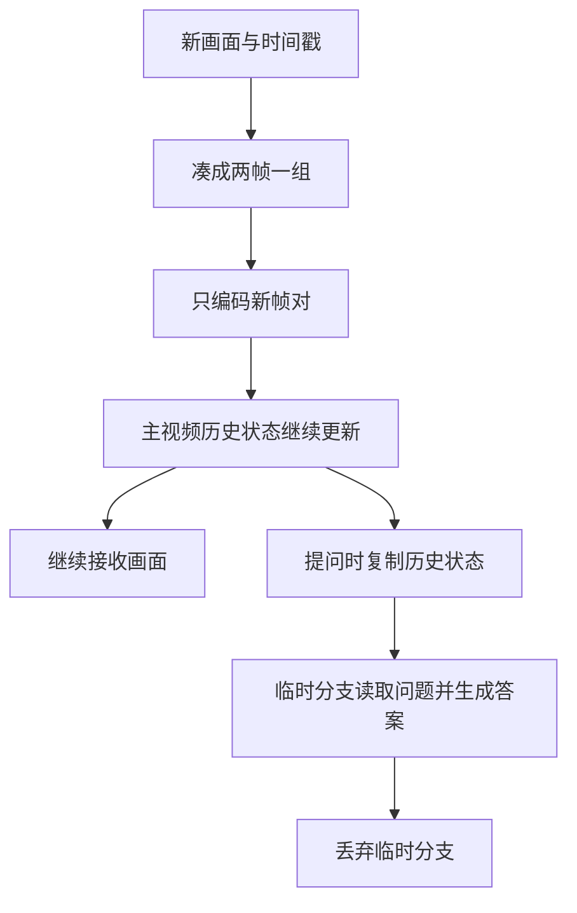

# 流式视频架构学习复盘与未解决问题

2026-10-10。本文件是截至本轮的学习复盘快照，持续进度只以实验总纲为准。阅读本文不启动推理；本轮只核对已有代码/运行证据，不新增GPU、训练或远程作业。

## 1. 我们目前做成了什么

我们以合作仓库Qwen3.5-0.8B为起点，完成了原模型小基线、分批读视频的应用层滑窗、混合历史状态的增量续接、问答分支隔离、容量保护与同步演示，并保存了真实成功和失败记录。

最重要的区别是：**历史状态接得对，不等于模型能正确使用历史回答问题。** 固定FP32高精度、相同实际视觉特征的测试支持目前的语言续接机制；低精度BF16及独立视觉编码的严格数值比较仍有失败。当前主体可以在少量控制中正确更新，早期主体、顺序、数量等能力仍有反例。因此现阶段是可解释、可复现的有界学习原型，不是已经验收完毕的长期实时视频系统。

本次核对：既有FP32回归/共享视觉/同步演示/跨场景/原六帧等长控制的完成状态和摘要，最近交付审计、实际源文件与Git分支/base/remote。累计本机GPU运行23次（包括历史失败尝试），集群作业0、训练0；不把这些次数当成独立视频数或准确率。

## 2. 先理解原模型怎样看视频

可以把视频模型想成两个合作的人：一个把画面整理成数字笔记，另一个读这些数字和问题，再组织答案。

画面首先经过预处理和视觉编码，变成视觉Token。Token可以暂时理解为“模型能读的一小块数字信息”，不一定是一句话或一个物体。语言部分同时读视频信息、时间表达和问题，然后生成答案。原模型短视频推理一般把当前整段输入一次处理，再用缓存逐个生成回答。

把视频拆成几段循环调用原模型，并不自动等于持久流式模型。如果每次都把最近四帧完整重算，那只是应用层滑窗；如果每次重新开一个缓存，上一轮就没有在模型内部续接下来。

## 3. 我们的流式原型怎样工作

**第一步，保证新画面按顺序到来。** 我们保留真实采样时间、帧编号，并检查重复、乱序、画布形状和关闭后操作。回答只能基于当时已交给模型的输入；文件重放的解码器可能内部缓冲，不能夸称完全不预读。

**第二步，两帧一起处理。** 本模型的视觉时间补丁需要两帧。来一帧先暂存，第二帧到齐才编码。文件结束只剩一帧时，明确复制它补齐，但真实画面数量仍计一帧，不额外制造一个真实事件。

**第三步，接上历史。** 旧画面在当前会话中不重新视觉编码，只把新视频Token继续接入主语言序列。位置也要接着往后走，不能新来一组就从零开始。视频包含时间和空间位置，不只是一个递增帧号。

**第四步，回答与观看分开。** 可以把主历史想成观看笔记。有人提问时，复制一份笔记去答题；答完丢掉副本，继续观看用原笔记。这样模型刚刚生成的“手”“猫”等文字不会被追加进主视频历史，下一次视频输入仍沿着原观看状态继续。

**第五步，历史装不下时明确重置。** 当前演示在接入新帧前检查实际Token容量，装不下就清空旧会话历史，保留待处理的新帧，再开始新会话。它保护了资源和输入完整性，却会失去更早会话的历史；重置不是长期记忆方案。

### 历史并不只有KV Cache

Qwen3.5语言部分24层中，6层是普通注意力、18层是Gated DeltaNet。因此我们要一起管理四类状态：key_cache、value_cache、conv_states、recurrent_states，还有Token/位置计数及模型对象上的rope_deltas。

可以把普通注意力的K/V理解为方便查阅旧内容的详细数字笔记，把递归状态理解为不断更新的一份紧凑内部记录，卷积状态则保留接续下一段所需的最近局部信息。这只是帮助理解的比喻：内部记录并不是可读文字摘要，也不保证保存了我们关心的每个细节。

KV Cache已经在使用。我们新增的关键工作是让视频多Token输入也能正确续接所有混合状态，而不是仅复制一个KV张量。裁剪KV也不会自动擦除递归状态中的旧影响，因此以后做淘汰或长期记忆时，必须整体设计。

## 4. 为什么之前遇到这么多问题

### 原缓存路径只适合某些续接方式

原源码的Gated DeltaNet路径在多Token缓存续接时会重建卷积状态，且没有正确接入此前的递归初始状态。可以想成：上一段笔记已经写好，下一段却从部分空白笔记起步。我们在S4独立分支修复了多Token续接，原S1–S3模型副本保留不改。

微型高精度检查和固定官方权重FP32回归给出了通过证据，包括分块布局、问答分支、重置和容量拒绝。但真实BF16测试仍有数值失败，所以不能把结构修复写成“所有精度已经等价”。

### 相同画面不一定得到逐位相同的视觉数字

一边每来两帧就编码，一边把完整视频一起编码，得到的特征有微小差异。后面的多层语言计算会传播这些差异，最终可能超出严格数值门槛。视觉内部具体哪个算子最先产生差异，尚未定位。

我们把在线路径实际产生的视觉特征原样交给完整语言参照，同输入的五组严格比较通过；随后只换回独立整段视觉特征，两组旧失败再次出现。这支持该固定例的语言续接，同时保留完整视觉比较尚未通过的事实。不能靠答案文字相同代替数值和状态比较。

### 回答错了，需要先确认原模型是否也错

“手→猫”的第一帧题先在在线模型中答错；共享实际视觉输入的整段语言参照也答错。随后原未改模型独立编码整个六帧，在BF16和FP32中仍答CAT。因此这个错误无需S4改造便会发生。

只取原前四帧，手可以答HANDS。再保持两段视频都为六帧、前四帧手完全相同，只替换末两帧，结果如下：

| 输入 | 第一帧应是什么 | 原模型两种精度的回答 |
|---|---|---|
| 前四帧手、末两帧手 | 手 | HANDS，正确 |
| 同样前四帧手、末两帧猫 | 手 | CAT，错误 |

在这个固定等长例子中，末尾内容改变足以改变并使早期回答错误。长度本身不能解释两例差别。但还不能定位为唯一的末帧偏好、注意力问题、视觉表征变化或递归遗忘，也不能证明所有流式改造都没有影响。主体始终是手的控制答对，亦不证明模型分清FIRST与LAST。

### 记录工具错误与模型错误要分开

历史上出现过Windows编码读取错误、CPU/GPU输入副本混用、NumPy不支持BF16指纹等诊断工具故障，已修正并保留失败记录。聊天结束符也已兼容，避免答案结束后继续生成。这些修复让实验运行与记录更可靠，并没有修好“第一帧答成猫”这样的理解问题。已修复的具体工具故障不列成当前模型未解决问题。

## 5. 已有证据支持到哪里

| 证据 | 已支持 | 仍不能据此推出 |
|---|---|---|
| 原模型文字/图像/短视频基线 | 原固定模型及输入接口可运行 | 任意视频都理解正确 |
| S3有限压力200采样帧、100问答 | 有限滑窗负载下状态/资源判据通过，颜色81/100 | 持久流式历史、长期墙钟稳定或摄像头实时 |
| 官方权重固定FP32十项回归 | 固定输入的混合状态分块、分支、reset和容量机制通过 | BF16/所有输入/独立在线视觉整体等价 |
| 共享实际视觉特征五组、跨场景八组严格控制 | 这些固定FP32同输入语言参照通过，问答不污染主状态 | 回答语义必然正确 |
| 23采样帧同步演示，7回答、3reset | 新帧对编码、触发、重置保留新帧、隔离和清理成立 | 无界历史、异步摄像头、生产端到端延迟 |
| 跨场景当前主体4帧4/4、6帧4/4 | 少量控制里可随当前画面更新主体 | 一般事件顺序或可靠早期记忆 |
| 原四帧与六帧等长FIRST控制 | 早期手可识别；固定例末尾内容影响早期回答 | 唯一内部原因、通用准确率或已经解决历史理解 |

小样例有重复精度、重复帧、重复问题和同期反例复现，不能把各轮分母加起来报总体准确率。原S3是独立窗口重算，S4才是持久混合状态原型，也不能把两阶段资源结果混在一起证明长期增量稳定。

## 6. 当前未解决的问题

下面的“已有失败”与“未验证/未实现”分开列。它们不是同一类故障，也不应全部用训练处理。

| 问题 | 目前事实 | 意味着什么 / 下一验证方向 |
|---|---|---|
| BF16低精度多Token续接数值不等价【已有失败】 | 原官方BF16七布局中六个超门槛；局部FP32归一化、逐Token递归候选也未修复整模型真实GPU | 不能宣称高效低精度流式已经验收；若优先工程化，需要固定输入定位误差传播，不能只看最终词或放宽门槛 |
| 独立成对/整段视觉编码的严格整体比较【已有失败，原因部分定位】 | 同实际视觉输入语言参照通过；换独立视觉特征的四帧/EOF控制仍失败 | 视觉差异足以影响本固定例的严格结果；首次产生差异的算子及适用范围未定位 |
| 早期主体受末尾内容影响【已有失败，内部原因未知】 | 原六帧同前四手，末手→HANDS、末猫→CAT；正确目标均手，两精度一致 | 原模型目标能力确有反例；未区分视觉、语言位置词理解、注意力和递归影响，不能直接判定缓存损坏 |
| 顺序、数量和颜色识别不可靠【已有失败】 | 自然顺序2/4，正倒序都答FAUCET；可见双手数量题答ONE；合成颜色81/100 | 主体识别正例不能代表细节/时序能力；应按具体任务做独立标签与固定配对，不合并成通用准确率 |
| 时间表达敏感性【已有现象，未普遍解决】 | 选中的四个颜色错误改局部时间只纠正2/4；时间文本改变也会改变Token数/位置 | 未证明哪种时间表达普遍更好，也未定位内容与位置影响；默认真实PTS未静默替换 |
| 无界历史与跨reset长期回忆【未实现】 | 容量保护靠拒绝或显式reset；演示3次reset会清除旧epoch | 不能跨任意长历史持续回忆；若确需该能力，再定义淘汰、摘要或外部记忆的质量/预算验收 |
| 摄像头、异步队列、长时间服务和真实延迟【未验证】 | 现有为有限同步文件快速重放，没有按墙钟等待或真实摄像头 | 缺乏排队/掉帧/背压/问答期间继续收帧、长时资源增长与完整延迟证据 |
| 泛化与评测覆盖【证据不足】 | 自然素材主要为猫/洗手两段，有限合成样例；标签含助手目视判定，非双人独立标注 | 需要独立留出样例、更多变化/小物体/动作与标注复核；当前不是公开基准成绩 |
| 性能优化和跨环境复现【尚未完成】 | 单样本RTX4060 Laptop，固定环境，FLA/causal-conv1d未安装、使用torch回退，主要成功参考用FP32 | 尚未证明其他设备/backend等价，未完成长期/多流吞吐或综合瓶颈分析；短例峰值不能当生产资源保证 |
| 集群运行【工程阻碍】 | 历史SSH认证失败，无远程命令成功/作业结果 | 远程认证及独立新环境需另处理；本次全部是本地结果，未部署集群 |
| GitHub协作交付【工程待办】 | 本次核验origin指向合作仓库、个人分支/base不变，提交身份未配置；未commit/push/PR，写权限未核验 | 需要确认真实Git身份及协作权限、审阅后提交个人分支，经PR合并main，不覆盖同学文件 |

## 7. KV、Token压缩、记忆森林和训练何时进入

**KV与递归缓存：已经在用。** 下一关注点是正确性、状态大小和历史生命周期。普通KV裁剪不是当前递归记忆的完整淘汰方案。

**Token压缩：明确Token读取成为瓶颈后再考虑。** 先量视觉编码、语言读取、问答副本和缓存成本；若压缩在视觉编码之后，只能节省后续计算，不能说视觉编码已经加速。还需检查小目标、计数、动作和顺序信息的损失。

**记忆森林：需要跨窗口/跨重置事件回忆时再考虑。** 它是额外的事件组织与检索设计，需要回答怎样建事件、怎样合并、怎样找回、怎样输入模型和避免重复计入历史。把信息组织起来，也不保证原模型能正确使用它。

**SFT：结构与输入已经可信、目标错误可明确标注时再考虑。** 需要按截至当时的前缀构造答案，避免未来信息泄漏，明确训练范围、梯度与预算，并用独立样例验收。SFT不能用来掩盖BF16续接数值错误或接口错误；当前训练0。

## 8. 下一步如何选择

本次先完成复盘和未解决问题清单，不同时开展所有方向，也不新增GPU。后续如果优先可用工程，先选择BF16数值或独立视觉差异这一类明确机制问题；如果优先视频理解，选择有独立金标的早期/顺序任务；如果优先演示，另登记长时间/真实输入与队列预算。每次只推进一个目标，先预检、再固定小预算，保留失败。

学习阶段的成果已经足够解释：新帧怎样进来、为什么两帧一组、历史在哪些状态中、位置怎样延续、问题为何另开分支、容量满为何重置，以及为什么数值通过仍可能答错。接下来选择哪一个工程或研究问题，应由目标决定，不由“还有机制没加”决定。

## 9. 回查入口

项目根E:\VIT Model；主记录[实验总纲](<E:/VIT Model/实验总纲.md>)，当前模型说明[合作仓库架构与计划解读](<E:/VIT Model/合作仓库架构与计划解读.md>)。运行证据分布在runs各独立目录，最近交付目录s4b_equal_tail_delivery_check_20261010_01。

主要结果文档：FP32混合状态回归结果.md、逐层精度诊断与递归参考结果.md、共享视觉特征控制结果与复现.md、同步成对帧演示结果与复现.md、自然视频结果与复现.md、长运行与重置结果.md、原模型六帧等长末尾对照结果.md。当前源目录code/qwen35-streaming-s4/streaming中的hybrid.py、online.py、demo.py分别对应状态所有权、成对帧/问答、演示触发；qwen35_local/modeling_qwen3_5.py对应模型混合层实现。原S1–S3及只读reference保留，不覆盖旧项目或同学文件。
